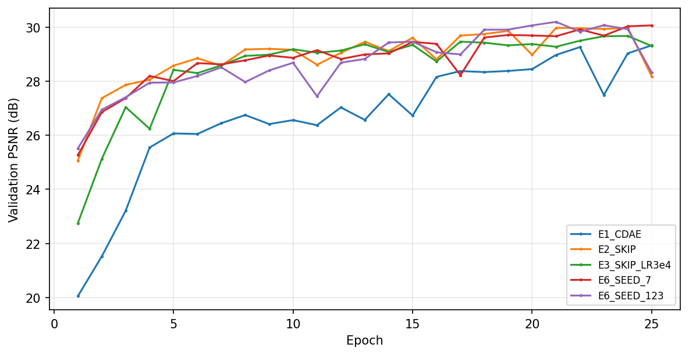
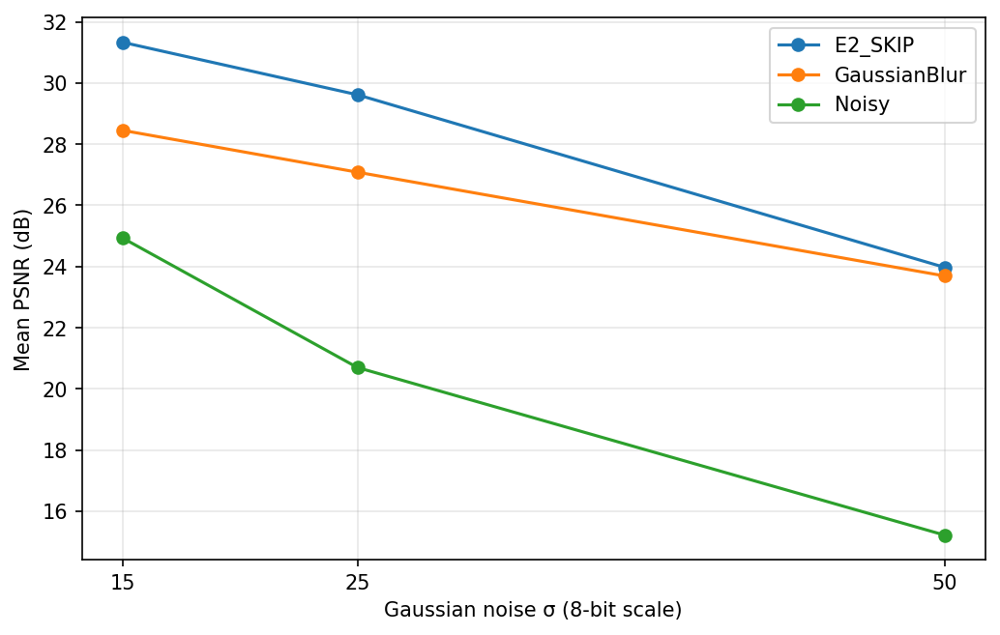

# Відновлення зашумлених зображень за допомогою автоенкодера

Проєкт із дисципліни «Нейронні мережі». Досліджено відновлення кольорових фотографій, до яких додано гаусівський шум. Реалізація виконана в PyTorch і запускається в Kaggle Notebook на GPU.

Порівнюються звичайний згортковий автоенкодер (CDAE) та його модифікація зі skip connections (Skip-CDAE). Окремо перевірено вплив learning rate, відтворюваність результатів за різних random seeds і якість відновлення при зміні рівня шуму.

## Дані та постановка задачі

Використано RGB-зображення високої роздільності з [DIV2K](https://data.vision.ee.ethz.ch/cvl/DIV2K/):

- **720** зображень із `DIV2K_train_HR` — навчання;
- **80** зображень із `DIV2K_train_HR` — внутрішня валідація;
- **100** зображень із `DIV2K_valid_HR` — відкладене фінальне тестування.

Це власний поділ даних: останні 100 фотографій не є офіційним challenge-test DIV2K. Ідентифікатори фотографій між вибірками не перетинаються; списки та параметри поділу збережено в [`results/manifests`](results/manifests).

Зашумлене зображення утворюється за формулою `y = clip(x + n, 0, 1)`, де `n ~ N(0, (σ/255)²)`. Для навчання використано `σ = 25`; на тесті перевірено `σ = 15, 25, 50`. Мережа навчається мінімізувати MSE між чистим та відновленим зображеннями. Якість оцінюється за PSNR і SSIM, додатково — за MSE та MAE.

## Реалізація

Обидві архітектури побудовані за принципом encoder–decoder із двома етапами зменшення роздільності й bilinear upsampling у декодері. У Skip-CDAE ознаки з енкодера передаються до відповідних шарів декодера. Обидві моделі містять **417 059 навчуваних параметрів**.

Основні налаштування:

| Параметр | Значення |
| --- | --- |
| Оптимізатор | Adam |
| Функція втрат | MSE |
| Навчальні фрагменти | 96 × 96 |
| Фрагментів на епоху | 3000 |
| Batch size | 32 |
| Кількість епох | до 25 |
| Early stopping | patience = 6 (у виконаних запусках не спрацював) |
| Обчислення | NVIDIA Tesla T4, AMP |
| Основний seed | 42 |

Для валідації використовувалися фіксовані фрагменти та реалізації шуму. Найкращий checkpoint вибирався за середнім validation PSNR при `σ = 25`. Фінальне тестування проводилося після вибору моделі.

## Навчальні експерименти

| Запуск | Архітектура | Seed | Learning rate | Найкраща епоха | Validation PSNR, dB |
| --- | --- | ---: | ---: | ---: | ---: |
| E1_CDAE | CDAE | 42 | 0.001 | 25 | 29.326 |
| E2_SKIP | Skip-CDAE | 42 | 0.001 | 21 | 29.975 |
| E3_SKIP_LR3e4 | Skip-CDAE | 42 | 0.0003 | 23 | 29.664 |
| E6_SEED_7 | Skip-CDAE | 7 | 0.001 | 25 | 30.065 |
| E6_SEED_123 | Skip-CDAE | 123 | 0.001 | 21 | 30.197 |

У порівнянні E1 та E2 skip connections дали приріст **0.649 dB** за validation PSNR без збільшення кількості параметрів. Водночас CDAE мав вищий validation SSIM (`0.804` проти `0.783`). Зменшення learning rate до `0.0003` у межах 25 епох не покращило PSNR.

Для перевірки стабільності Skip-CDAE навчено з seeds 42, 7 і 123. Середній найкращий validation PSNR — **30.0789 dB**, вибіркове стандартне відхилення — **0.1116 dB**. Це оцінка розкиду за трьома запусками, а не гарантія однакової якості на будь-якому обладнанні.

## Результати на відкладеній тестовій вибірці

Для фінального тестування використано **E2_SKIP**, обрану за результатами початкового порівняння E1–E3. Додаткові запуски зі зміною seed не використовувалися для повторного вибору фінальної моделі.

Наведено середні значення за 100 фотографіями для кожного рівня шуму.

| σ / 255 | Вхідне зображення PSNR / SSIM | Gaussian Blur PSNR / SSIM | Skip-CDAE PSNR / SSIM |
| --- | --- | --- | --- |
| 15 | 24.93 / 0.516 | 28.45 / 0.788 | **31.33 / 0.861** |
| 25 | 20.70 / 0.350 | 27.08 / 0.703 | **29.61 / 0.791** |
| 50 | 15.22 / 0.178 | 23.69 / 0.517 | **23.98 / 0.531** |

При `σ = 25` модель перевищила Gaussian Blur на **2.53 dB PSNR**. За сильнішого шуму `σ = 50` різниця зменшилася до **0.28 dB**. Навчання на одному рівні шуму обмежує узагальнення на значно складніші умови; дрібні текстури та контури залишаються складними для відновлення.

Приклади відновлення зображень і карти помилок містяться в [`results/figures`](results/figures). Повна таблиця метрик — [`results/test_summary.csv`](results/test_summary.csv); результати для кожної фотографії — [`results/test_per_image.csv`](results/test_per_image.csv).

## Запуск у Kaggle

1. Створити Kaggle Notebook або імпортувати файл [`DIV2K_Autoencoder.ipynb`](DIV2K_Autoencoder.ipynb).
2. Додати до **Input** набір даних із папками `DIV2K_train_HR` та `DIV2K_valid_HR`. Notebook шукає ці директорії всередині `/kaggle/input`.
3. У **Settings → Accelerator** вибрати GPU. Перевірити доступність CUDA у першій кодовій комірці.
4. Запустити комірки послідовно (**Run All**) у новому середовищі без результатів старого навчання.

Основні параметри змінюються на початку Notebook: `SEED`, `PATCH_SIZE`, `PATCHES_PER_EPOCH`, `BATCH_SIZE`, `MAX_EPOCHS`, `RUN_STABILITY`, `RUN_FINAL_TEST`. За поточної конфігурації виконуються три основні навчальні експерименти, два повтори для стабільності та фінальний тест.

Результати зберігаються в `/kaggle/working/denoising_autoencoder`. Для повторного запуску з тими самими назвами експериментів потрібне чисте робоче середовище: код навмисно не перезаписує наявні checkpoint-и.

Використано Python 3.13, PyTorch 2.11, NumPy, pandas, OpenCV, Pillow, scikit-image і Matplotlib. Версії середовища фактичного запуску збережено в [`results/environment.json`](results/environment.json). Для запуску потрібен GPU з підтримкою CUDA; результати не гарантовано збігатимуться побітово на різних пристроях.

## Файли проєкту

- `DIV2K_Autoencoder.ipynb` — код, налаштування, результати виконання та візуалізації;
- `report.md` — технічний звіт і висновки;
- `results/experiments.csv` — порівняння навчальних запусків;
- `results/stability_val.csv` — результати трьох seeds;
- `results/test_summary.csv`, `results/test_per_image.csv` — підсумкові та пофотографічні метрики;
- `results/runs/*/config.json`, `history.csv`, `summary.json` — конфігурації та історії запусків;
- `results/manifests/` — списки зображень і фіксованих валідаційних фрагментів;
- `results/figures/` — графіки навчання, порівняння методів і приклади відновлення;
- `results/MODEL_SELECTION.md` — рішення щодо фінальної моделі.

Великі файли ваг моделей і оригінальні фотографії DIV2K до цього репозиторію не додаються. Checkpoint-и `best.pt` збережено окремо в архіві результатів виконання Kaggle.

## Джерела

- [DIV2K — ETH Zürich](https://data.vision.ee.ethz.ch/cvl/DIV2K/)
- [Vincent et al., *Extracting and Composing Robust Features with Denoising Autoencoders* (2008)](https://www.cs.toronto.edu/~larocheh/publications/icml-2008-denoising-autoencoders.pdf)
- [Ronneberger et al., *U-Net: Convolutional Networks for Biomedical Image Segmentation* (2015)](https://arxiv.org/abs/1505.04597)
- [PyTorch — Automatic Mixed Precision](https://docs.pytorch.org/docs/stable/amp.html)
- [scikit-image — image metrics](https://scikit-image.org/docs/stable/api/skimage.metrics.html)
